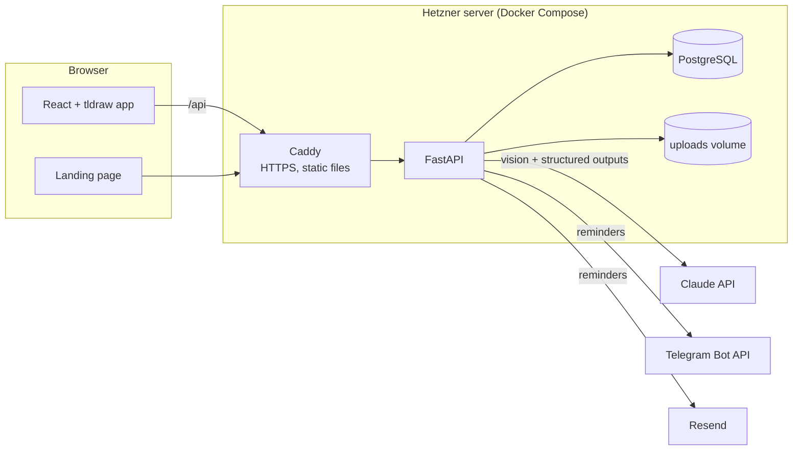
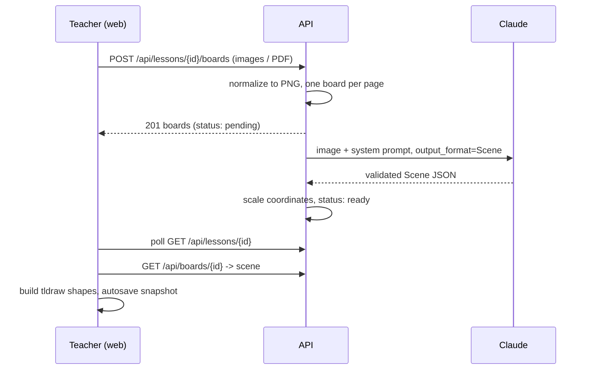

# Architecture

## Data model

| Table | Purpose |
|---|---|
| `users` | Teachers and students. Students belong to one teacher and carry reminder settings (language, Telegram chat ID, channels, next lesson time). |
| `lessons` | One tutoring session: title, subject, time, tutor notes, AI summary and its status. |
| `boards` | One whiteboard image of a lesson: the stored PNG, AI scene, tldraw snapshot and status. |
| `reminders` | Log of every reminder attempt per channel. It is also the dedup key for scheduled reminders. |

Tables are created on startup (`Base.metadata.create_all`). Alembic migrations are on the
[roadmap](roadmap.md) before real data goes into production.

## Request flow: uploading a board

Background work runs in-process via FastAPI `BackgroundTasks`. Each job opens its own DB
session and records failures on the row instead of raising. A dedicated queue (Redis + arq) is
only worth it once a single server can't keep up.

## Board rendering

The scene is deliberately simpler than tldraw's own record format. The model describes **what**
is on the board and **where**, and `web/src/board/sceneToShapes.ts` maps it to shapes:

| Scene element | tldraw shape |
|---|---|
| original image | locked `image` shape, opacity adjustable |
| `text` | `text` (hand-drawn font) |
| `math` | custom `math` shape, KaTeX-rendered, LaTeX-editable |
| `geo` | `geo` |
| `arrow` | `arrow` |
| `draw` | `line` (cubic spline) |

After the first user edit, the full tldraw snapshot is stored and becomes the source of truth for
that board. Re-running reconstruction clears the snapshot and rebuilds the board from the new
scene.
