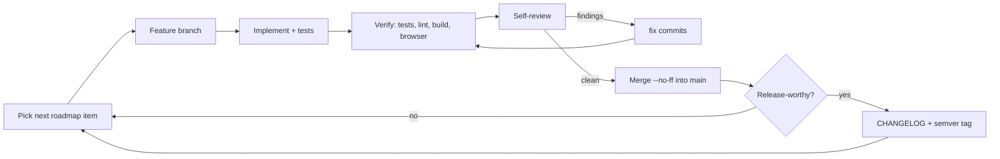

# Built on autopilot

Chalkback is also an experiment: the human owner set the goal and the constraints, and an AI coding
agent (Claude Code) does the engineering. It writes the code, reviews it, fixes its own review
findings, merges, cuts releases, writes these docs, builds the landing page and deploys.

## The loop

Every merge commit summarizes what the branch did and how it was verified. Every self-review
finding gets its own `fix(...)` commit, so the history shows what the agent caught in its own
work. The landing page's timeline is generated from this history by
`scripts/autopilot_log.py`.

## Phase 1: local

The repository runs locally with real branches, merge commits and tags. There is no remote yet.

## Phase 2: GitHub (now)

| Step | How |
|---|---|
| Pull requests | The agent pushes each branch and opens a PR with `gh pr create` |
| Review | `.github/workflows/ai-review.yml` runs Claude on every PR. GitHub doesn't let a PR author approve their own PR, so the review is posted as comments ending in a verdict. Needs the `ANTHROPIC_API_KEY` secret and the variable `AI_REVIEW_ENABLED=true`. Until then the agent posts its self-review as a PR comment |
| Fixes | The agent addresses the comments with new commits on the same PR |
| Merge | After CI is green and the verdict is "ready to merge", the agent merges with `gh pr merge` |
| Releases | Pushing a `vX.Y.Z` tag runs `.github/workflows/release.yml`, which publishes a GitHub release from `CHANGELOG.md` |
| Deploy | `.github/workflows/deploy.yml` deploys `main` to Hetzner after CI passes |
| Periodic work | A scheduled agent session (or scheduled workflow) picks up roadmap items and cuts releases on a cadence |

## Guardrails

The agent has broad permissions, but only inside a sandbox:

- a GitHub token scoped to this one repository;
- a server that exists only for this project;
- no other secrets on the machine it runs on;
- the public demo contains only fictional student data.
